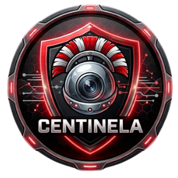
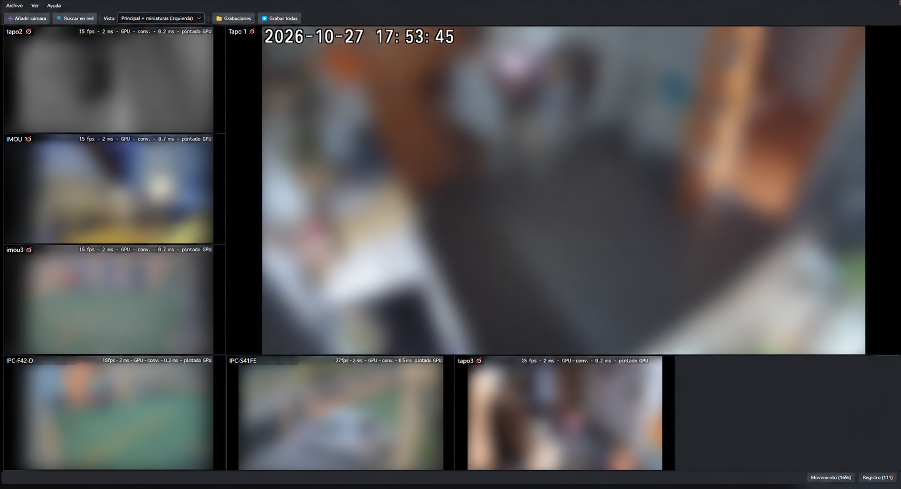

<p align="center">
  
</p>

<h1 align="center">Centinela</h1>

<p align="center">
  <strong>Tus cámaras de seguridad, en directo y en privado.</strong><br>
  Visor de cámaras IP para Windows, macOS y Linux. Sin nube, sin cuentas y con el mínimo retraso.
</p>

<p align="center">
  <a href="https://github.com/tecxion/centinela/releases/latest"></a>
  
  <a href="https://github.com/tecxion/centinela/actions/workflows/paquetes.yml"></a>
  <a href="https://github.com/tecxion/centinela/releases"></a>
  <a href="LICENSE"></a>
</p>

<p align="center">
  <a href="#descarga"><strong>Descargar</strong></a> ·
  <a href="#características">Características</a> ·
  <a href="#instalación">Instalación</a> ·
  <a href="#guía-rápida">Guía rápida</a> ·
  <a href="#solución-de-problemas">Solución de problemas</a>
</p>

<p align="center">
  
</p>

---

Centinela reúne todas tus cámaras de vigilancia en una sola ventana. La imagen va **directamente de la cámara a tu
ordenador** por tu red local: no pasa por servidores ajenos, no hay que crear ninguna cuenta y el retraso es el
mínimo que permite la cámara. Graba, hace capturas, detecta movimiento, te avisa cuando pasa algo y sigue vigilando
con la ventana cerrada.

Funciona con **TP-Link Tapo**, **Imou** y cualquier cámara **RTSP/ONVIF**.

## Por qué Centinela

| | |
|---|---|
| ⚡ **En directo de verdad**<br>Recibe el vídeo sin búfer y lo decodifica y dibuja con la tarjeta gráfica. Lo que ves es lo que está pasando. | 🔒 **Tus imágenes no salen de casa**<br>Sin nube, sin cuentas, sin publicidad. Las contraseñas se guardan en el almacén seguro de tu sistema. |
| 👁 **Vigila aunque no mires**<br>Detección de movimiento por cámara, avisos del sistema, horas de silencio y registro de eventos. | 🖥️ **Una app, tres sistemas**<br>Las mismas funciones en Windows, macOS (Apple Silicon e Intel) y Linux, con paquetes que lo traen todo. |

## Características

| | |
|---|---|
| 🎥 **Imagen en directo** | Latencia mínima con FFmpeg, decodificación y pintado por GPU y colores fieles a la cámara. |
| 🔍 **Búsqueda automática** | Encuentra las cámaras de tu red por ONVIF, también en otras redes o VLAN. O añádelas a mano. |
| 🧩 **Vistas** | Cuadrícula (Auto, 1, 4, 9, 16), *Principal + miniaturas* y *Dos principales + miniaturas*. Arrastra para reordenar. |
| ⏺ **Grabación y capturas** | Vídeo MKV sin recodificar (una cámara o todas a la vez) y capturas PNG a resolución completa. |
| 🚨 **Detección de movimiento** | Marco rojo, notificaciones, registro, sensibilidad, tiempo entre avisos y horas de silencio. |
| 🔊 **Sonido** | Escucha una cámara a la vez, con silencio de un clic. |
| 🔎 **Zoom digital** | Hasta 8× con la rueda del ratón; arrastra para moverte. |
| 📶 **Cámaras con wifi pobre** | Cambio HD/SD, ajuste de resolución, fps y bitrate de la propia cámara y modo *Suavizar imagen*. |
| 💾 **Copias de seguridad** | Exporta e importa tus cámaras (con contraseñas protegidas por clave) y copia automática. |
| 🔔 **En segundo plano** | Sigue grabando y vigilando desde la bandeja del sistema o la barra de menús, y arranca al iniciar sesión. |
| 🔄 **Actualizaciones** | Te avisa cuando hay una versión nueva. Nunca descarga ni instala nada por su cuenta. |

## Descarga

Versión actual: **1.4.0**. Cada paquete lleva todo lo necesario (.NET, FFmpeg y OpenAL): no hay que instalar nada
más.

| Sistema | Descarga directa | Requisitos |
|---|---|---|
| **Windows** | [`Centinela-1.4.0-windows-x64.exe`](https://github.com/tecxion/centinela/releases/download/v1.4.0/Centinela-1.4.0-windows-x64.exe) | Windows 10 u 11 de 64 bits |
| **macOS** con Apple Silicon (M1 o posterior) | [`Centinela-1.4.0-macos-arm64.dmg`](https://github.com/tecxion/centinela/releases/download/v1.4.0/Centinela-1.4.0-macos-arm64.dmg) | macOS 14 Sonoma o posterior |
| **macOS** con Intel | [`Centinela-1.4.0-macos-intel.dmg`](https://github.com/tecxion/centinela/releases/download/v1.4.0/Centinela-1.4.0-macos-intel.dmg) | macOS 14 Sonoma o posterior |
| **Linux** | [`centinela_1.4.0_amd64.deb`](https://github.com/tecxion/centinela/releases/download/v1.4.0/centinela_1.4.0_amd64.deb) | Ubuntu 22.04 o posterior, o una derivada (64 bits) |

También: [huellas `SHA256SUMS.txt`](https://github.com/tecxion/centinela/releases/download/v1.4.0/SHA256SUMS.txt) ·
código fuente en [.zip](https://github.com/tecxion/centinela/archive/refs/tags/v1.4.0.zip) o
[.tar.gz](https://github.com/tecxion/centinela/archive/refs/tags/v1.4.0.tar.gz) ·
[todas las versiones](https://github.com/tecxion/centinela/releases).

> ¿Qué Mac tengo? Menú Apple › **Acerca de este Mac**: si pone «Chip Apple M…» es Apple Silicon; si pone
> «Procesador … Intel», es Intel.

> [!IMPORTANT]
> Los únicos archivos oficiales son los de [github.com/tecxion/centinela/releases](https://github.com/tecxion/centinela/releases),
> generados por GitHub Actions a partir de este código. Todavía no llevan firma de código, así que Windows y macOS
> avisan la primera vez que los abres (más abajo se explica qué hacer). No te fíes de copias descargadas de otros
> sitios.

### Comprobar la descarga

Cada versión publica un `SHA256SUMS.txt` con la huella de cada archivo. Calcula la del tuyo y comprueba que coincide
con su línea:

| Sistema | Orden (en la carpeta de la descarga) |
|---|---|
| Windows (PowerShell) | `Get-FileHash .\Centinela-*-windows-x64.exe -Algorithm SHA256` |
| macOS (Terminal) | `shasum -a 256 Centinela-*.dmg` |
| Linux (Terminal) | `sha256sum centinela_*_amd64.deb` |

## Instalación

### Windows

1. Abre `Centinela-<versión>-windows-x64.exe`.
2. Si aparece **«Windows protegió su PC»**, pulsa **Más información › Ejecutar de todas formas**. El aviso sale
   porque el instalador de Windows no lleva firma de código; si lo has bajado de Releases y su huella coincide, es el
   oficial.
3. Sigue el asistente. Centinela se instala solo para tu usuario (sin pedir permisos de administrador), en
   `%LOCALAPPDATA%\Programs\Centinela`, con acceso en el menú Inicio y en el escritorio. Si quieres, marca
   **Arrancar con Windows**.

¿Tenías la 1.3? Instala la nueva encima: tus cámaras, ajustes y contraseñas se conservan.

### macOS

1. Abre el `.dmg` y arrastra **Centinela** a la carpeta **Aplicaciones**.
2. Abre Centinela desde Aplicaciones. La primera vez macOS no lo deja abrir, porque todavía no está notarizado por
   Apple: cierra el aviso (sin elegir «Trasladar a la Papelera»), ve a *Ajustes del Sistema › Privacidad y
   seguridad*, baja hasta *Seguridad* y pulsa **Abrir igualmente** junto a Centinela. Hay que hacerlo con cada versión
   nueva.
   Si no aparece el botón, escribe en Terminal `xattr -dr com.apple.quarantine /Applications/Centinela.app` y vuelve
   a abrirlo.
3. La primera vez, macOS te pide algunos permisos:
   - **Red local**: imprescindible, sin él Centinela no ve las cámaras. Si lo denegaste, actívalo en
     *Ajustes del Sistema › Privacidad y seguridad › Red local*.
   - **Notificaciones**: para los avisos de movimiento y de conexión.
   - **Documentos**: para guardar la copia automática de tus cámaras.
   - **Llavero**: tras instalar cada versión nueva, macOS pregunta si Centinela puede usar las contraseñas guardadas,
     una vez por cámara. Escribe la contraseña del Mac y pulsa **Permitir siempre**.

El botón rojo esconde la ventana en la barra de menús y Centinela sigue grabando. Para cerrarla del todo, <kbd>⌘</kbd><kbd>Q</kbd>.

### Linux

Desde la carpeta de la descarga (normalmente `~/Descargas`):

```bash
sudo apt install ./centinela_*_amd64.deb
```

Ábrelo desde el menú de aplicaciones o escribiendo `centinela` en una terminal.

- **Icono en la barra superior:** en Ubuntu sale de serie. En otros escritorios GNOME hace falta la extensión
  *AppIndicator and KStatusNotifierItem Support*. Sin bandeja, la X minimiza la ventana en lugar de esconderla.
- **Contraseñas:** se guardan en el llavero del escritorio (por ejemplo, GNOME Keyring). Si no hay llavero,
  Centinela las guarda cifradas en un archivo que solo puede leer tu usuario, y te lo dice.

## Preparar las cámaras

Centinela se conecta a las cámaras por **RTSP** (el vídeo) y **ONVIF** (búsqueda y ajustes). Cada marca lo activa
de una forma:

| Marca | Qué hacer | Usuario y contraseña en Centinela |
|---|---|---|
| **TP-Link Tapo** | App Tapo › la cámara › ⚙️ › *Ajustes avanzados* › **Cuenta de la cámara**: crea un usuario y una contraseña. | Los de esa cuenta, no los de tu cuenta TP-Link. |
| **Imou** | En algunos modelos hay que activar RTSP/ONVIF en la app Imou. | Usuario `admin`; contraseña: el **código de seguridad** de la pegatina. |
| **Otras** | Activa RTSP en su app o su web y apunta la dirección del flujo principal y del secundario. | Los que tenga configurados la cámara. |

<details>
<summary>Direcciones RTSP que usa Centinela (las pone sola según la marca)</summary>

| Marca | Calidad alta (principal) | Calidad baja (secundario) |
|---|---|---|
| Tapo | `rtsp://IP:554/stream1` | `rtsp://IP:554/stream2` |
| Imou | `rtsp://IP:554/cam/realmonitor?channel=1&subtype=0` | `…&subtype=1` |

</details>

> **Consejo:** reserva en tu router una IP fija para cada cámara (reserva DHCP) para que no cambie de dirección.

## Primeros pasos

1. Pulsa **🔍 Buscar en red** para encontrar tus cámaras, o **➕ Añadir cámara** para escribir sus datos a mano
   (nombre, marca, IP, usuario y contraseña).
2. En la ventana de la cámara pulsa **Probar**: comprueba la calidad alta y la baja y te dice la resolución, el códec
   y si tiene audio, o qué falla («Contraseña incorrecta», «Sin conexión»…).
3. Guarda. La cámara aparece en la ventana principal.
4. Elige cómo verlas en **Vista**.

## Guía rápida

Lo más importante, en breve. Dentro de Centinela, **Ayuda › Manual** lo explica todo, adaptado a tu sistema.

### Ventana principal

- **Vista**: cuadrícula (Auto, 1, 4, 9 o 16) o una cámara grande con miniaturas. En *Principal + miniaturas*, un
  clic en una miniatura la pone en grande. En *Dos principales + miniaturas*, el clic sustituye a la grande que lleva
  más tiempo sin cambiar, y arrastrar una miniatura sobre una grande la pone ahí.
- **Arrastrar** una cámara sobre otra las cambia de sitio. **Doble clic**: pantalla completa en calidad alta.
- **📁 Grabaciones** abre la carpeta de vídeos; **⏺ Grabar todas** / **⏹ Detener todas**.
- Barra inferior: estado de las cámaras, **Movimiento** (eventos sin ver) y **Registro** (errores).

### Botones de cada cámara

Aparecen al pasar el ratón: en las cámaras grandes, abajo en el centro; en las miniaturas, arriba a la derecha.

| Botón | Qué hace |
|---|---|
| **HD / SD** | *(cámaras grandes)* Cambia entre calidad alta y baja. Se recuerda. |
| 🔇 / 🔊 | *(cámaras grandes con audio)* Activa o silencia el sonido. Solo suena una cámara a la vez. |
| 👁 | Activa o desactiva la detección de movimiento. |
| 📷 | Captura PNG a resolución completa. |
| ⏺ | Empieza o detiene la grabación (un punto rojo junto al nombre indica que graba). |
| ✎ | Editar la cámara. |
| 🗑 | Eliminar la cámara. |

El **clic derecho** añade: Pantalla completa · Duplicar… · Calidad de la cámara… · Suavizar imagen · Restablecer zoom.

### Zoom digital

En las cámaras grandes y a pantalla completa: **rueda del ratón** para acercar (hasta 8×, hacia el puntero),
**arrastrar** para moverse y <kbd>0</kbd> con el puntero encima para volver a 1×.

### Movimiento y avisos

- Actívala con el botón 👁 de cada cámara (viene apagada). Mientras hay movimiento, la cámara muestra un **marco rojo**.
- Con la ventana minimizada o escondida, sale una notificación del sistema; un clic en ella abre Centinela.
- **Movimiento** (barra inferior) abre el registro: hora, cámara, duración e intensidad.
- **Ver › Opciones de avisos…**: por cámara, la sensibilidad, el tiempo mínimo entre avisos y qué avisos quieres;
  además, los sonidos de aviso y unas **horas de silencio** (por ejemplo, 23:00–07:00) en las que no suena ni avisa
  nada, aunque todo se sigue registrando.

### En segundo plano

Cerrar la ventana no cierra Centinela: la esconde y sigue grabando y vigilando.

| | Al cerrar la ventana | Para volver | Arranque automático |
|---|---|---|---|
| **Windows** | Se esconde en la bandeja, junto al reloj | Clic en el icono de la bandeja | **Arrancar con Windows** |
| **macOS** | Se esconde en la barra de menús | El icono de la barra de menús o el Dock | **Abrir al iniciar sesión** |
| **Linux** | Se esconde en la barra superior (sin bandeja, se minimiza) | El icono de la barra superior | **Arrancar al iniciar sesión** |

La opción de arranque está en el menú del icono (o en **Archivo**) e inicia Centinela escondida. Para cerrarla del
todo: **Salir** en ese menú o en *Archivo › Salir*.

### Grabaciones, capturas y copias

- Las grabaciones van a la carpeta de vídeos de tu sistema, en `Centinela/<cámara>/`, en formato **MKV** sin perder
  calidad; se abren con [VLC](https://www.videolan.org). Las capturas van a `Imágenes/Centinela/`.
- **Archivo › Exportar JSON…** guarda la lista de cámaras. Puedes proteger las contraseñas con una clave; sin clave se
  exporta sin contraseñas. **Importar JSON…** añade las nuevas y actualiza las que ya tienes.
- Así también pasas tus cámaras **a otro equipo o a otro sistema**: exporta con clave en uno e importa en el otro.
- Además, Centinela guarda una **copia automática sin contraseñas** (`Documentos/Centinela/camaras-copia.json`) cada
  vez que cambias algo. Formato de ejemplo: [`docs/ejemplo-camaras.json`](docs/ejemplo-camaras.json).

### Estadísticas y actualizaciones

- **Ver › Mostrar estadísticas** muestra en cada cámara los fps, lo que tarda el ordenador en preparar cada imagen y
  si usa la tarjeta gráfica (GPU) o el procesador (CPU). Esos milisegundos **no** son el retraso total desde la cámara
  (ese no se puede medir).
- Una vez al día Centinela mira si hay una versión nueva y te avisa con el archivo que corresponde a tu equipo.
  También puedes mirarlo en **Ayuda › Buscar actualizaciones…**.

### Atajos

| Atajo | Acción |
|---|---|
| <kbd>F11</kbd> | Ventana principal a pantalla completa y vuelta |
| <kbd>Esc</kbd> | Salir de pantalla completa |
| Doble clic en una cámara | Pantalla completa en calidad alta |
| Rueda del ratón | Zoom en cámaras grandes y a pantalla completa |
| <kbd>0</kbd> | Quitar el zoom de la cámara bajo el puntero |
| Arrastrar | Reordenar cámaras (o moverse con zoom) |

## Cámaras con mala conexión (wifi lejana)

Si una cámara va a tirones, casi siempre es porque su señal wifi no da para los datos que envía. Prueba en este orden:

1. **Botón HD/SD** de la cámara grande: pasa a la calidad baja, mucho más ligera.
2. **Clic derecho › Calidad de la cámara…**: muestra la resolución, los fps y el bitrate con los que emite la cámara
   y, si la cámara lo permite por ONVIF, deja cambiarlos.
   - **Recomendados (wifi pobre)** rellena valores ligeros (≈720p · 10 fps · 768 kbps en alta y ≈360p · 10 fps ·
     256 kbps en baja). No cambia nada hasta que pulsas **Aplicar…** y confirmas.
   - El cambio se guarda en la propia cámara, así que también afecta a su app y a sus grabaciones en la nube.
   - **Valores originales** vuelve a rellenar los que tenía antes del primer cambio.
3. **Clic derecho › Suavizar imagen**: la imagen va 1–2 s por detrás, pero fluida, sin acelerones tras un corte.
   Un ⏱ junto al nombre indica que está activo.
4. Si nada de eso basta, la solución es de red: acercar el router, poner un **repetidor wifi** o usar cable.

## Tus datos

| Qué | Windows | macOS | Linux |
|---|---|---|---|
| Cámaras, ajustes y registros | `%AppData%\Centinela` | `~/Library/Application Support/Centinela` | `~/.local/share/centinela` |
| Contraseñas | Cifradas por Windows (DPAPI) para tu usuario | Llavero de macOS | Llavero del escritorio, o archivo cifrado |
| Grabaciones | `Vídeos\Centinela\<cámara>` | `Películas/Centinela/<cámara>` | `Vídeos/Centinela/<cámara>` |
| Capturas | `Imágenes\Centinela` | `Imágenes/Centinela` | `Imágenes/Centinela` |
| Copia automática | `Documentos\Centinela` | `Documentos/Centinela` | `Documentos/Centinela` |

Los registros de errores y de movimiento están en la subcarpeta `logs` y se borran solos a los 14 días.

## Privacidad y seguridad

- **Sin nube ni cuentas.** El vídeo va directamente de la cámara a tu ordenador por tu red local.
- **Contraseñas en el almacén seguro del sistema**: la protección de datos de Windows, el Llavero de macOS o el
  llavero del escritorio en Linux. Nunca aparecen en registros, avisos ni copias sin clave.
- Para la búsqueda y los ajustes de la cámara (ONVIF) solo se usa autenticación Digest: la contraseña no viaja en claro.
- La única conexión a Internet es la comprobación de actualizaciones, que solo envía a GitHub la versión de Centinela.

## Solución de problemas

<details>
<summary><strong>«Contraseña incorrecta» o «Usuario o contraseña incorrectos»</strong></summary>

- **Tapo:** usa la *Cuenta de la cámara* creada en la app Tapo, no el correo de tu cuenta TP-Link.
- **Imou:** usuario `admin` y el **código de seguridad** de la pegatina (distingue mayúsculas).
- Tras varios intentos fallidos algunas cámaras se bloquean unos minutos: espera y vuelve a probar.
</details>

<details>
<summary><strong>«Sin conexión · reintentando»</strong></summary>

- Comprueba que el ordenador y la cámara están en la misma red y que la IP no ha cambiado (mira la app de la cámara).
- Reserva una IP fija para la cámara en el router.
- Algunas Imou necesitan activar RTSP/ONVIF en su app.
- **En el Mac**, comprueba que Centinela tiene permiso en *Ajustes del Sistema › Privacidad y seguridad › Red local*.
</details>

<details>
<summary><strong>La búsqueda en red no encuentra una cámara</strong></summary>

- **¿Están las cámaras en otra red?** Por ejemplo, el ordenador en `192.168.1.x` y las cámaras en `192.168.2.x`, o
  en una red de invitados o una VLAN. La búsqueda normal no cruza el router. En *Redes donde buscar*:
  - pulsa **📡 Detectar otras redes**: Centinela recorre tu zona de red (unos 20–30 s), muestra las cámaras que
    encuentra y añade sus redes a la lista;
  - marca las redes que quieras y pulsa **🔍 Buscar**. Las redes marcadas se recuerdan para la próxima vez;
  - si conoces la red, escríbela (`192.168.2.0/24`, `192.168.2.*` o `192.168.2.1-50`) y pulsa **Añadir red**.
- Algunas cámaras no responden a la búsqueda ONVIF, sobre todo si la tienen desactivada. Añádela con
  **➕ Añadir cámara** escribiendo su IP.
</details>

<details>
<summary><strong>La imagen va a tirones</strong></summary>

Mira [Cámaras con mala conexión](#cámaras-con-mala-conexión-wifi-lejana). Con *Ver › Mostrar estadísticas*, si los
fps saltan entre 0 y valores muy altos, el problema es la wifi de esa cámara.
</details>

<details>
<summary><strong>No se oye nada</strong></summary>

- El botón 🔊 solo aparece en cámaras grandes o a pantalla completa, y si la cámara envía audio (actívalo en su app).
- Todas empiezan en silencio: pulsa 🔇 para escuchar. El volumen se regula en el mezclador de sonido del sistema.
</details>

<details>
<summary><strong>Una cámara dice «Falta la contraseña»</strong></summary>

Pasa cuando los datos vienen de otro equipo o sistema (por ejemplo, al copiar la carpeta de datos de Windows al Mac):
las contraseñas cifradas solo se pueden leer en el equipo donde se guardaron. Pulsa **Editar** y escríbela de nuevo,
o pasa las cámaras con *Exportar JSON…* con clave e *Importar JSON…*.
</details>

<details>
<summary><strong>Linux: no sale el icono en la barra superior</strong></summary>

Tu escritorio no tiene bandeja del sistema. En GNOME, instala y activa la extensión *AppIndicator and
KStatusNotifierItem Support* (en Ubuntu viene de serie como *Ubuntu AppIndicators*) y vuelve a abrir Centinela.
Mientras tanto, Centinela funciona igual: la X minimiza la ventana y la opción de arranque está en el menú **Archivo**.
</details>

Si el problema sigue, abre **Registro** (barra inferior), pulsa *Copiar* y escríbenos (ver [Soporte](#soporte-y-licencia)).

## Actualizar y desinstalar

**Actualizar:** cuando Centinela te avise, descarga el paquete nuevo e instálalo encima, como la primera vez (cierra
antes Centinela con **Salir**). Tus cámaras y ajustes se conservan.

**Desinstalar:** primero desactiva el arranque automático en el menú del icono y sal de Centinela. Después:

- **Windows:** *Configuración › Aplicaciones*, busca Centinela y pulsa **Desinstalar**.
- **macOS:** arrastra Centinela de Aplicaciones a la Papelera.
- **Linux:** `sudo apt remove centinela`.

Tus datos no se borran al desinstalar. Si quieres borrarlos, elimina la carpeta de datos (ver [Tus datos](#tus-datos))
y, si quieres, las grabaciones y capturas. En el Mac, las contraseñas siguen en el Llavero: ábrelo con *Acceso a
Llaveros* y busca `es.tecxart.centinela`.

> **¿Venías de CamaraWin?** Centinela se llamaba así antes. En Windows, la primera vez copia tus cámaras y ajustes de
> `%AppData%\CamaraWin` sin tocar la carpeta antigua. Las grabaciones antiguas siguen en `Vídeos\CamaraWin`.

## Para desarrolladores

### Estructura

```
src/
  Centinela.Desktop/   Interfaz Avalonia: ventanas, vistas, vídeo, bandeja
  Centinela.Core/      Lógica sin dependencias: modelo, vistas, ONVIF, movimiento, copias, actualizaciones
  Centinela.Media/     FFmpeg: sesiones RTSP, decodificación por GPU, grabación, capturas, audio
  Centinela.Platform/  Lo propio de cada sistema: contraseñas, arranque, notificaciones, instancia única
tests/                 Pruebas de Core, Media (con un servidor RTSP local), Platform y Desktop
packaging/             Archivos del .dmg (macOS) y del .deb (Linux)
tools/                 Scripts: FFmpeg, paquetes, mediamtx, icono
docs/                  Guías de prueba, ejemplo de copia y documentos de diseño
```

Tecnologías: C# / .NET 10, [Avalonia UI](https://avaloniaui.net), [FFmpeg](https://ffmpeg.org) 9.0 (LGPL) con
[FFmpeg.AutoGen](https://github.com/Ruslan-B/FFmpeg.AutoGen), [OpenAL Soft](https://openal-soft.org) con
[Silk.NET](https://github.com/dotnet/Silk.NET), CommunityToolkit.Mvvm, Tmds.DBus y xUnit.

### Compilar desde el código

Necesitas Git y el [SDK de .NET 10](https://dotnet.microsoft.com/download/dotnet/10.0). Los paquetes que crees tú
son iguales que los oficiales, pero solo los de Releases son oficiales.

<details>
<summary><strong>Windows</strong> (PowerShell)</summary>

```powershell
winget install --id Git.Git -e
winget install --id Microsoft.DotNet.SDK.10 -e
git clone https://github.com/tecxion/centinela.git
cd centinela
powershell -ExecutionPolicy Bypass -File tools\get-ffmpeg.ps1     # FFmpeg LGPL en ffmpeg\
dotnet run --project src\Centinela.Desktop -c Release
powershell -ExecutionPolicy Bypass -File tools\build-installer.ps1 # crea dist\Centinela-<versión>-windows-x64.exe
```

`-ExecutionPolicy Bypass` permite esos scripts sin cambiar la configuración de tu equipo. El instalador necesita
[Inno Setup 6](https://jrsoftware.org/isinfo.php): `winget install JRSoftware.InnoSetup`.
</details>

<details>
<summary><strong>Linux</strong> (Ubuntu)</summary>

```bash
sudo apt install git curl xz-utils dpkg-dev dotnet-sdk-10.0
git clone https://github.com/tecxion/centinela.git
cd centinela
bash tools/get-ffmpeg.sh                                    # FFmpeg LGPL en ffmpeg/lib
dotnet run --project src/Centinela.Desktop -c Release
bash tools/build-deb.sh                                     # crea dist/centinela_<versión>_amd64.deb
```

Si `apt` no encuentra `dotnet-sdk-10.0`, sigue las [instrucciones de Microsoft](https://learn.microsoft.com/dotnet/core/install/linux-ubuntu).
Con `imagemagick` instalado, el icono del paquete sale con el tamaño justo.
</details>

<details>
<summary><strong>macOS</strong> (Terminal)</summary>

```bash
xcode-select --install                                      # herramientas de compilación de Apple
git clone https://github.com/tecxion/centinela.git
cd centinela
bash tools/get-ffmpeg-mac.sh arm64                          # compila FFmpeg (x64 para Intel; necesita nasm)
dotnet run --project src/Centinela.Desktop -c Release
bash tools/build-dmg.sh arm64                               # crea dist/Centinela-<versión>-macos-arm64.dmg
```

Las notificaciones solo funcionan dentro del `.app` (no con `dotnet run`). El `.dmg` lleva una firma ad hoc; con
`CODESIGN_IDENTITY` firma con tu propia identidad.
</details>

### Pruebas

```bash
dotnet test tests/Centinela.Core.Tests
dotnet test tests/Centinela.Platform.Tests
dotnet test tests/Centinela.Desktop.Tests
```

Las de `Centinela.Media.Tests` levantan un servidor RTSP local (de momento solo en Windows): descárgalo con
`powershell -ExecutionPolicy Bypass -File tools\get-mediamtx.ps1` y ten `ffmpeg` (con libx264) en el `PATH`.

<details>
<summary>Probar la aplicación sin cámaras reales</summary>

En una terminal, el servidor RTSP: `tools\bin\mediamtx.exe`. En otra, un vídeo de prueba:

```powershell
ffmpeg -re -f lavfi -i testsrc=size=1280x720:rate=25 -c:v libx264 -pix_fmt yuv420p -tune zerolatency -f rtsp rtsp://127.0.0.1:8554/prueba
```

Después añade una cámara de marca **Otra (RTSP)** con la URL principal `rtsp://127.0.0.1:8554/prueba` (en «Avanzado»).
</details>

### Variables de entorno

- **`CENTINELA_DATA_DIR`**: guarda todo (cámaras, ajustes, registros, copias, grabaciones y capturas) en esa carpeta.
  Es una instancia aparte de la que tengas abierta, usa un almacén de contraseñas de archivo en lugar del llavero, no
  toca el arranque automático y no busca actualizaciones al arrancar. Ideal para probar sin tocar tu instalación.
- **`CENTINELA_CPU_VIDEO=1`**: dibuja el vídeo con el procesador en lugar de la tarjeta gráfica, para comparar.

```bash
CENTINELA_DATA_DIR=/tmp/centinela-prueba dotnet run --project src/Centinela.Desktop     # añade "-- --tray" para arrancar escondida
```

En PowerShell: `$env:CENTINELA_DATA_DIR = "$env:TEMP\centinela-prueba"` y después el `dotnet run`.

### Publicar una versión

Cada subida a `master` crea los cuatro paquetes con el flujo
[Paquetes](https://github.com/tecxion/centinela/actions/workflows/paquetes.yml) de GitHub Actions; quedan en
*Artifacts* de cada ejecución (hace falta haber iniciado sesión en GitHub), para probarlos antes de publicar.

1. Cambia `<Version>` en `Directory.Build.props` y súbelo a `master`.
2. Crea y sube la etiqueta de esa versión:

   ```bash
   git tag v1.4.0
   git push origin v1.4.0
   ```

   El flujo crea los paquetes y deja una *release* **borrador** con ellos y el `SHA256SUMS.txt`. Si la etiqueta no
   coincide con `<Version>`, falla y no crea nada.
3. En [Releases](https://github.com/tecxion/centinela/releases), abre el borrador, revisa las notas, prueba los
   archivos y pulsa **Publish release**. Las copias instaladas la verán en su siguiente comprobación (los borradores y
   las *pre-releases* no cuentan).
4. Cambia la versión de los enlaces de [Descarga](#descarga) en este README (aparece en cada enlace).

Para cambiar el icono, sustituye `src/Centinela.Desktop/Assets/centinela.png` y regenera el `.ico` con
`powershell -ExecutionPolicy Bypass -File tools\make-icon.ps1`.

## Soporte y licencia

- **Soporte:** [www.tecxart.es](https://www.tecxart.es) · [tecxart@gmail.com](mailto:tecxart@gmail.com) · en la
  aplicación, *Ayuda › Soporte*.
- **Errores y sugerencias:** [issues en GitHub](https://github.com/tecxion/centinela/issues). Si te resulta útil,
  una ⭐ ayuda a que más gente lo encuentre.
- **Licencia:** [MIT](LICENSE). FFmpeg y OpenAL Soft se distribuyen bajo LGPL; ver
  [THIRD-PARTY-NOTICES.md](THIRD-PARTY-NOTICES.md).
